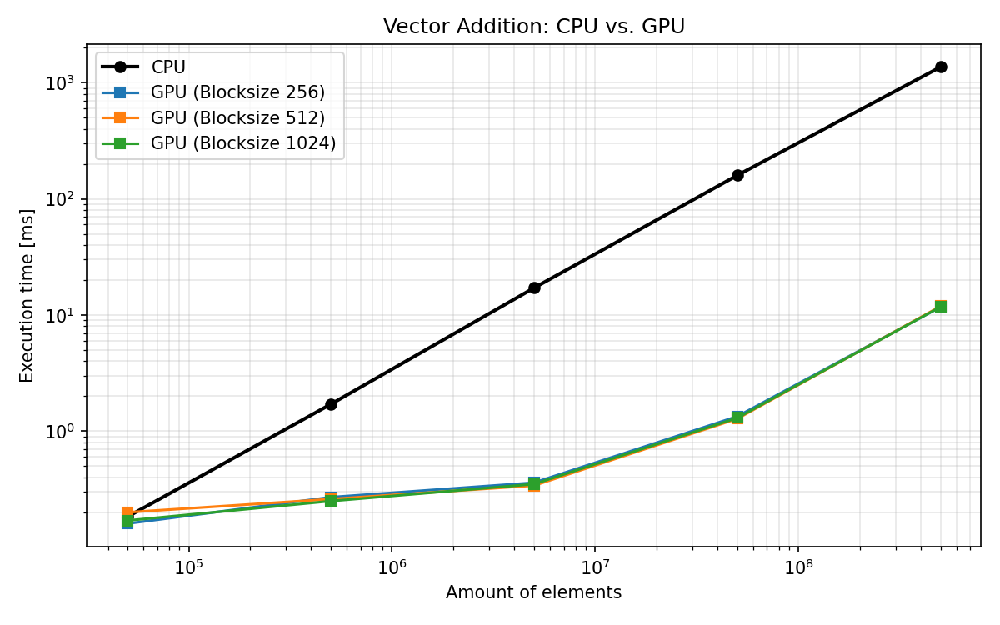

# GPUs vs CPUs – Lab 1: Architecture and Performance

In this lab we compare a CPU and a GPU on a simple, highly parallel task (vector addition), look at *why* the GPU is so much faster, and finally run into a classic parallel-programming bug: the **race condition**.

**Hardware used**

| | CPU | GPU |
|---|---|---|
| Model | Intel Xeon w3-2525 | NVIDIA RTX PRO 4000 (Blackwell) |
| Compute units | 8 cores / 16 threads | 70 SMs, 8,960 CUDA cores (128 per SM) |

---

## 1. What are GPUs used for?

**Graphics.** GPUs were built to render images: every pixel (or vertex) can be computed independently, so thousands of small computations run at the same time. This is still the core of games, 3D design, video editing and ray tracing.

**AI / Machine Learning.** Training and running neural networks is mostly matrix multiplication – the same simple operation applied to huge amounts of numbers. That maps perfectly onto a GPU, which is why modern AI (e.g. large language models) depends on GPUs.

Other areas: scientific simulation, video encoding, data analytics, crypto, ...

---

## 2. Experiment: Vector Addition

Task: `C[i] = A[i] + B[i]` for N floats. The same operation is implemented on both devices (see `addition.cu`):

```cuda
// GPU: one thread per element
__global__ void vectorAdd(const float *A, const float *B, float *C, int numElements) {
    int i = blockDim.x * blockIdx.x + threadIdx.x;
    if (i < numElements) C[i] = A[i] + B[i];
}

// CPU: one loop, one thread
void vectorAddCPU(const float *A, const float *B, float *C, int numElements) {
    for (int i = 0; i < numElements; ++i) C[i] = A[i] + B[i];
}
```

**Measurement**
- GPU: `cudaEvent` timing around the kernel launch.
- CPU: `clock()` around `vectorAddCPU`.
- Results of GPU and CPU are compared element by element ("Test PASSED").
- N from 50,000 to 500,000,000, block sizes 256 / 512 / 1024.

> Note: the GPU time covers the **kernel only**. Copying the data over PCIe (host → device and back) is not included.

### Results (ms)

| Elements | CPU | GPU (256) | GPU (512) | GPU (1024) |
|---:|---:|---:|---:|---:|
| 50,000 | 0.17–0.20 | 0.16 | 0.20 | 0.17 |
| 500,000 | 1.66–1.74 | 0.27 | 0.26 | 0.25 |
| 5,000,000 | 16.5–17.7 | 0.36 | 0.34 | 0.35 |
| 50,000,000 | 137–171 | 1.34 | 1.28 | 1.30 |
| 500,000,000 | 1360–1367 | 11.73 | 11.90 | 11.77 |



### Speed-up (CPU time / GPU time)

| Elements | 256 | 512 | 1024 |
|---:|---:|---:|---:|
| 50,000 | 1.1× | 1.0× | 1.0× |
| 500,000 | 6.4× | 6.6× | 6.6× |
| 5,000,000 | 49× | 51× | 47× |
| 50,000,000 | 102× | 134× | 131× |
| 500,000,000 | 117× | 114× | 116× |

### What we observe

1. **Small data: no benefit.** At 50,000 elements CPU and GPU are equally fast. The kernel launch overhead and the fact that the GPU is not fully utilised eat the advantage.
2. **Growing data: speed-up explodes.** The CPU time grows linearly with N, while the GPU time stays almost flat until the GPU is saturated. Beyond ~5 million elements the speed-up is ~100×.
3. **Block size barely matters** for this kernel. All three configurations are within a few percent of each other, because vector addition is limited by memory bandwidth, not by how threads are grouped. (Block size matters more for kernels that use shared memory or many registers.)
4. **The GPU is memory-bound.** For 500M elements the kernel moves 12 bytes per element (2 reads + 1 write) = 6 GB in ~11.8 ms, i.e. roughly 0.5 TB/s. The arithmetic itself (one addition) is trivial.

> One outlier: the CPU time at 50M elements with block size 256 (137 ms) is lower than in the other two runs (~170 ms). The CPU code does not depend on the block size, so this is most likely measurement noise (caches, frequency, other processes). A repeated measurement with an average would make the table cleaner.

---

## 3. Architecture: why is the GPU faster here?

| | CPU (Xeon w3-2525) | GPU (RTX PRO 4000) |
|---|---|---|
| Design goal | Low latency for a few complex tasks | High throughput for many simple tasks |
| Cores | 8 big cores, out-of-order execution, branch prediction | 8,960 small CUDA cores grouped in 70 SMs |
| Threads | 16 hardware threads | tens of thousands of threads in flight, switched with almost no cost |
| Cache | Large caches per core | Small caches, instead very high memory bandwidth |
| Best for | Complex logic, branching, sequential code | Same operation on huge data sets |

On the GPU, threads are organised in **blocks**, blocks form a **grid**, and each block runs on one SM. Inside a block, threads are executed in groups of 32 (**warps**) that execute the same instruction at the same time. This is why vector addition fits so well: every thread does the same thing on a different element.

Block size selects how many threads form one block (256 / 512 / 1024 here) and therefore how many blocks are created, e.g. 500M elements → 488,282 blocks of 1024 threads, or 976,563 blocks of 512 threads.

---

## 4. Race conditions

### The bug

`race_condition_bug.cu` counts how many elements of a vector are above a threshold. The naive kernel:

```cuda
if (i < numElements && A[i] > threshold) {
    (*count)++;          // BUG
}
```

`(*count)++` is not one operation, but three: **read** the value, **add 1**, **write** it back. Thousands of threads do this on the same memory address at the same time. Two threads can read the same old value, both add 1, and both write the same result, so one increment is **lost**. The final count is too small, and it is **different in every run**, which is why the program runs the kernel several times and compares with the CPU result.

### The fix

```cuda
if (i < numElements && A[i] > threshold) {
    atomicAdd(count, 1); // read-modify-write as one indivisible operation
}
```

`atomicAdd` makes the hardware execute the whole read-modify-write without interruption, so no update is lost. The result now matches the CPU in every run (**PASSED**).

### The price

Atomics on one single address force the threads to be serialised. This is correct, but it becomes a bottleneck when the number of elements (and therefore the number of colliding threads) grows.

### How race conditions are usually handled

- **Atomic operations** (`atomicAdd`, `atomicMax`, `atomicCAS`, ...) – simple, correct, but can be slow under high contention.
- **Reduction instead of a shared counter** – each block first counts locally (shared memory or warp shuffles), then only **one** `atomicAdd` per block is done. This is the standard high-performance solution.
- **Avoid sharing** – give every thread its own output location (like `C[i]` in the vector addition, which is why that kernel has no race condition).
- **Synchronisation** – `__syncthreads()` inside a block, or separate kernel launches as global barriers.
- **Libraries** – Thrust / CUB provide tested, optimised reductions.

On the CPU the same problem exists with multithreading and is solved with mutexes, atomics or thread-local counters.

---

## 5. Conclusion and what's next

- For massively parallel, simple operations the GPU was **~100× faster** than a single CPU thread on 50M–500M elements, while for small inputs there was no advantage.
- The block size had almost no influence for vector addition, because the kernel is limited by memory bandwidth.
- Parallelism brings new bug classes: the race condition showed that *correct-looking* code can give wrong and non-reproducible results, and that `atomicAdd` fixes it at a performance cost.

**Ideas for next steps**
- Include the host ↔ device transfer in the measurement (the speed-up will look much smaller).
- Compare against a multi-threaded CPU version (OpenMP) instead of one thread.
- Implement the block-level reduction for the counting kernel and measure it against the plain `atomicAdd`.
- Profile with Nsight to confirm the memory-bound behaviour.

---

## Repository contents

| File | Description |
|---|---|
| `addition.cu` | Vector addition on GPU and CPU with timing |
| `race_condition_bug.cu` | Counting kernel, race condition and `atomicAdd` fix |
| `results.csv` | Measurement results |
| `plot_cpu_vs_gpu.png` | CPU vs GPU execution time plot |
| `Solution.md` | Lab notes and task answers |
